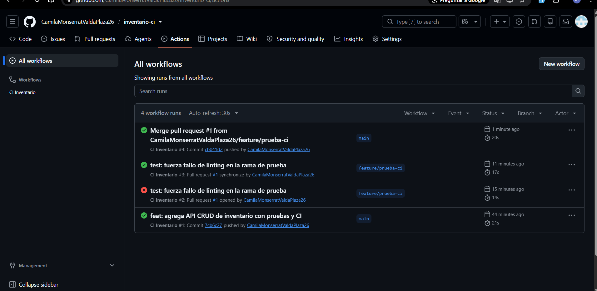

# Informe de Laboratorio 5.1 - Practica Individual

## 1. Descripcion del proyecto

API CRUD de inventario desarrollada con **Node.js** y **Express**. La entidad de dominio es **Producto**, con los campos `id`, `nombre`, `precio` y `stock`.

Endpoints disponibles:

| Metodo | Ruta | Descripcion |
|---|---|---|
| GET | `/health` | Estado del servicio |
| GET | `/productos` | Lista todos los productos |
| GET | `/productos/:id` | Obtiene un producto por id |
| POST | `/productos` | Crea un producto |
| PUT | `/productos/:id` | Actualiza un producto |
| DELETE | `/productos/:id` | Elimina un producto |

Las pruebas de integracion estan hechas con **Jest** y **Supertest**.

## 2. Pipeline de integracion continua

El workflow `CI Inventario` se ejecuta en cada `push` y `pull_request` hacia `main`. Incluye:

- **Checkout** del codigo.
- **Setup** de Node.js 20.
- **Instalacion** de dependencias con `npm ci`.
- **Linting** con ESLint.
- **Pruebas** con cobertura usando `jest --coverage`.
- **Publicacion** del reporte de cobertura como artefacto (`coverage-report`).

> El proyecto no requiere un paso de compilacion porque es JavaScript puro ejecutado con Node.js.

## 3. Evidencias

### 3.1 Historial de ejecuciones en la pestana Actions

### 3.2 Workflow exitoso con cobertura

### 3.3 Workflow fallido

### 3.4 Configuracion de la proteccion de rama

## 4. Conclusiones

La integracion continua permite detectar errores de linting y de pruebas antes de integrar cambios a `main`. La proteccion de rama obliga a que el workflow pase antes de fusionar, lo que mejora la calidad del codigo y evita subir cambios incompletos o defectuosos.
